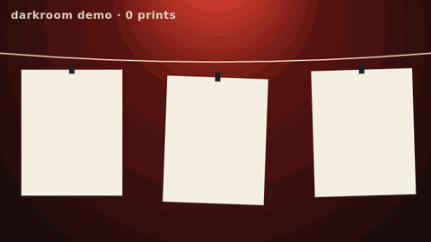
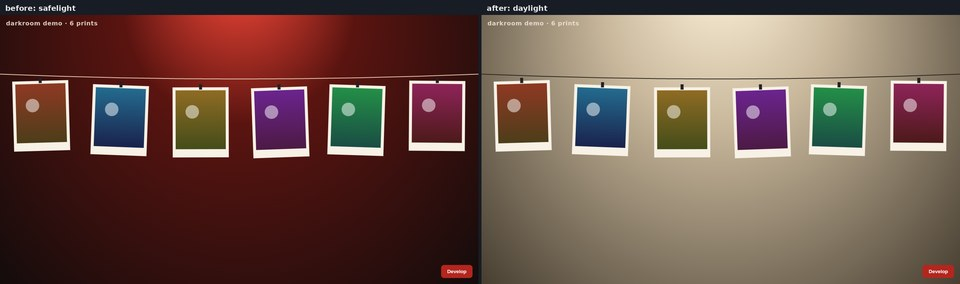
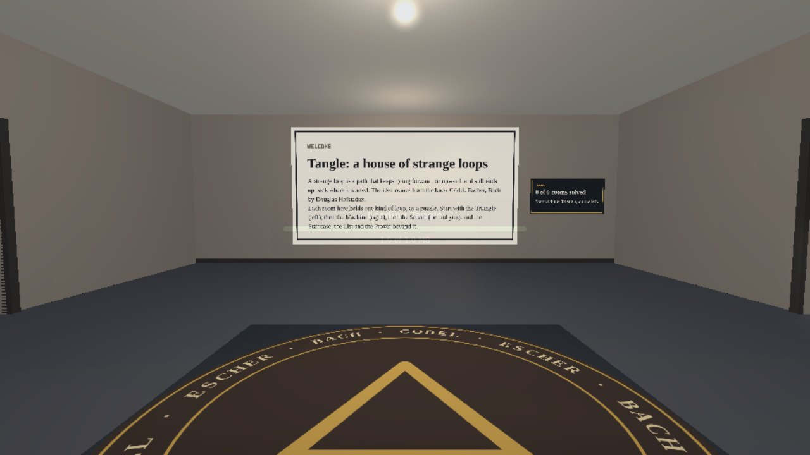
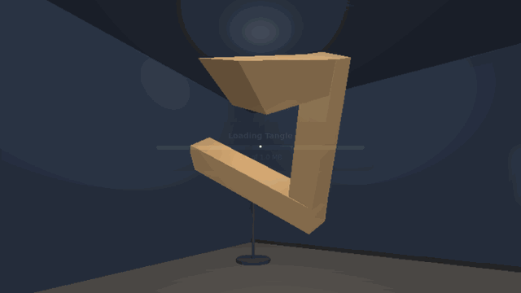

# darkroom

A small media-capture kit for project READMEs, release notes and pull requests. You write a
JSON shot list (`media.json`); darkroom drives a browser or runs your program, then makes
budget-fitted stills, GIFs, MP4/WebM clips, contact sheets, before/after pairs and a markdown
gallery you can paste anywhere.


*darkroom's own demo page, shot by `examples/static-page/media.json` (42 KB JPEG).*

- **Two backends.** `web` drives headless Chromium through Playwright (with a deterministic
  clock for [Strata](https://github.com/Preponderous-Software/strata) web-kit games, or any
  page through JS hooks). `command` runs any program that writes images (a native game's
  screenshot flag, an engine's headless renderer, a heavy server-and-bot rig), each on its
  own Xvfb display if you want one.
- **Budgets by default.** Stills under 200 KB, GIFs under 3 MB, MP4 under 600 KB, WebM under
  400 KB. darkroom steps quality, colours, width and frame rate down until a file fits, and
  says what it did.
- **Built for slow, crowded machines.** Every shot retries with a fresh browser or process,
  finished shots are skipped on the next run, a failing shot doesn't stop the others, and
  named file locks keep heavy rigs to one at a time.

## Install

Python 3.10 or newer. Pillow is the only required dependency.

```sh
pip install "darkroom[video] @ git+https://github.com/Preponderous-Software/darkroom"
```

- `[video]` adds `imageio-ffmpeg`, which ships an ffmpeg binary for MP4 and WebM. An
  `ffmpeg` on `PATH` (or `$DARKROOM_FFMPEG`) is used first. With neither, video outputs
  are skipped with a message and everything else still works.
- The `web` backend needs Node.js and Playwright (`npm i playwright && npx playwright
  install chromium`). darkroom looks for `playwright` in the manifest's `node_modules`, then
  `$NODE_PATH`, then `$DARKROOM_PLAYWRIGHT`.
- The `command` backend's `xvfb: true` needs `Xvfb` (`apt install xvfb`).

## Quickstart

```json
{
  "out": "docs/media",
  "vars": { "base": "http://127.0.0.1:8000/" },
  "shots": [
    {
      "name": "title", "kind": "still", "device": "desktop",
      "url": "{base}", "ready": "document.querySelector('canvas')",
      "caption": "The title screen.", "alt": "The game's title screen"
    },
    {
      "name": "walk", "kind": "clip", "device": "phone",
      "url": "{base}?demo=1",
      "steps": [ { "repeat": 24, "steps": [ { "key": "KeyW", "action": "down" }, { "wait": 80 }, { "capture": true } ] } ],
      "gif": { "fps": 12 }, "video": ["mp4"],
      "caption": "Walking north.", "alt": "Animation: the player walks north"
    }
  ]
}
```

```sh
darkroom check media.json                       # validate, with the exact place of each problem
darkroom shoot media.json                       # shoot everything that isn't up to date
darkroom shoot media.json --only walk --force   # reshoot one
darkroom gallery media.json --relative-to README.md   # print markdown for the outputs
```

`darkroom shoot` prints each output and its size:

```text
> developing (clip, web)
  developing.gif: 334 KB
  developing.mp4: 42 KB (crf 23)
  developing.webm: 39 KB (crf 33)
  developing-poster.jpg: 19 KB
  developing-sheet.png: 484 KB
= desktop: up to date (use --force to reshoot)
```

## What it makes

| Shot | Output |
|---|---|
| a still on a 390x844 DPR-3 touch phone, after a `tap` and a `waitFor` |  |
| a clip: 36 frames, each stepped by a JS hook, as a GIF with an adaptive palette (plus MP4, WebM and a poster) |  |
| a before/after pair from two tagged runs of the same shot |  |
| a `command` still: any program that writes PNGs into `{out_dir}` |  |

A contact sheet of every frame of a clip (`darkroom sheet media.json developing`), for
reviewing a take before you publish it:


### Dogfood: Tangle

[Tangle](https://github.com/Preponderous-Software/tangle) is a first-person game on Strata.
`examples/tangle/media.json` is a port of its own capture script: it loads the game with
`?drive=1`, poses the player through the game's JS hook, steps the engine clock exactly
(`frames`), hides the HUD with `css`, and captures.





*The 12-frame cut of `triangle-closes` (118 KB GIF, 47 KB MP4), shot in software WebGL on a
heavily loaded machine. The full clip is 50 frames.*

## Manifest reference

Top level:

| Key | Meaning |
|---|---|
| `out` | Output directory, relative to the manifest (default `media`). |
| `vars` | Values for `{name}` placeholders in `url`, `ready`, `argv`, `env` and `cwd`. Vars may use other vars. `--var name=value` overrides. Built in: `{manifest_dir}`, and for `command` shots `{out_dir}`, `{width}`, `{height}`, `{dpr}`, `{display}`, `{name}`, `{tag}`, `{i}`, `{n}`. Unknown placeholders are left alone, so JS and JSON braces are safe. |
| `devices` | Extra devices: `{ "name": { "width", "height", "dpr", "touch", "mobile" } }`. |
| `budgets` | `still_kb` (200), `gif_mb` (3), `mp4_kb` (600), `webm_kb` (400). A shot can override any of them in its own `budgets`. |
| `defaults` | Fields every shot starts from (objects merge one level deep; fields for the other backend are ignored). |
| `shots` | The list of shots. |

Every shot:

| Key | Meaning |
|---|---|
| `name` | Unique; becomes the file name (`name.jpg`, `name.gif`, ...). |
| `kind` | `still` (one image), `clip` (frames from `capture` steps), or `pair` (before/after). |
| `backend` | `web` (default) or `command`. |
| `device` | `desktop` (1280x720), `hd` (1920x1080), `phone` (390x844, DPR 3, touch, mobile), `landscape-phone` (844x390), a custom name, or an inline `{ "width", "height", ... }`. |
| `caption`, `alt` | Used by the gallery. Say so in `alt` if `speed` > 1. |
| `format`, `quality`, `width` | Stills: `jpg` (default) or `png`, starting JPEG quality (86), maximum width. |
| `aspect` | Centre-crop every frame to a ratio such as `"16:9"` or `"1:1"`. |
| `fps`, `speed` | Clip playback rate (12) and a speed-up factor. |
| `gif` | `{ fps, width (640), palette, colors (256), dither (false), loop (0), budget_mb }`, or `false` for no GIF. Palettes: `octree` (per frame; keeps small saturated details), `median` (per frame, median cut), `adaptive` (one octree palette for the whole clip: no colour flicker). |
| `video` | `["mp4"]`, `["webm"]` or both. |
| `poster` | Frame for a poster JPEG: an index, or a fraction of the clip (default 0.6 when there is video). |
| `sheet` | `true` also publishes the contact sheet (one is always kept with the take). |
| `retries`, `timeout`, `lock` | Attempts after the first (2), seconds per attempt, a lock name. |
| `skip` | Leave the shot out of `shoot`. |

### The web backend

| Key | Meaning |
|---|---|
| `url` | The page (templated). `file://{manifest_dir}/index.html` works for static pages. |
| `adapter` | `hook` (default; any page, waits are wall-clock) or `strata-kit` (waits for `window.__strataKit`; `frames` drives its clock by exactly 1/30 s per frame; `camera` sets `__strataKit.cam`). |
| `ready` | A JS expression to wait for before the steps (default `window.__strataKit` or `true`). |
| `readyTimeout`, `waitUntil` | Milliseconds to wait for the page (120000) and the navigation event (`load`, `domcontentloaded`, `commit`). |
| `css` | Styles injected once the page is ready (hide the HUD). |
| `setup`, `steps` | Step lists, run in that order. A still is the page after the steps; a clip is every `capture`. |
| `crop` | `[x, y, width, height]` in CSS pixels: capture only that part of the page. |
| `failOnConsoleError` | Fail the attempt if the page logs an error (errors are always reported). |
| `userAgent`, `block` | darkroom appends `darkroom-monitor` to Chromium's user agent, so sites that count visits can skip captures. `block` is a list of URL patterns to abort (analytics, scores). |
| `launchArgs` | Chromium flags. The default renders WebGL with SwiftShader, so it works headless and in CI. |

Steps (one verb per object):

| Step | Does |
|---|---|
| `{"js": "expr or statements"}` | Runs in the page. Sees `vars`, and inside a `repeat`: `i`, `n` and `u` (`i / (n - 1)`, for easing). |
| `{"key": "KeyW", "action": "down"}` | `down`, `up` or `press` (default). |
| `{"type": "hello"}` | Types text. |
| `{"tap": [x, y]}` | A touch tap on touch devices, a click otherwise. |
| `{"click": "css selector"}` | Clicks an element. |
| `{"wait": 250}` | Waits, in wall-clock milliseconds. |
| `{"waitFor": "js expr", "timeout": 30000}` | Waits until the expression is truthy: game state, not guesswork. |
| `{"frames": 6}` | `strata-kit`: drives 6 frames of game time. `hook`: waits 6 animation frames. |
| `{"camera": {"yaw": 0.5, "dist": 8}}` | `strata-kit` only: sets any of `yaw`, `pitch`, `dist`, `tx`, `ty`, `tz`. |
| `{"css": "..."}` | Injects styles at this point. |
| `{"capture": true}` | Adds a frame to a clip. |
| `{"mark": "in"}` / `{"mark": "out"}` | Trims the clip to the frames between the marks. |
| `{"repeat": 36, "var": "i", "steps": [...]}` | Runs the inner steps `n` times. |

### The command backend

| Key | Meaning |
|---|---|
| `argv` | The program and its arguments, templated. It must write image files into `{out_dir}` (a fresh temporary directory per run). |
| `env`, `cwd` | Extra environment (templated) and working directory (default: the manifest's). |
| `xvfb` | `true` (or `{ "args": [...] }`) runs the program on a private Xvfb display sized to the device. Xvfb picks a free display number itself, so parallel captures never collide; `{display}` and `$DISPLAY` hold it. Xvfb and the program run with software OpenGL (`LIBGL_ALWAYS_SOFTWARE=1`, `GALLIUM_DRIVER=llvmpipe`), which keeps GLX working where a host GPU driver would crash it (e.g. NVIDIA under WSL), so the program gets real OpenGL; `{ "env": {...} }` replaces those variables and `{ "env": {} }` drops them. If Xvfb still crashes at startup, darkroom starts it once more without GLX and warns. |
| `repeat` | Run the program `n` times with `{i}` and `{n}` set; every image from every run is a frame, in order (camera orbits, scenario steps). |
| `glob` | Which files to collect (default: every PNG, JPEG, WebP or BMP, sorted). |

`examples/recipes/media.json` shows a native game with its own screenshot flags at three
sizes, an engine's headless renderer, two builds compared as a pair, and a RAM-heavy rig
behind a lock.

### Pairs

```json
{ "name": "title-compare", "kind": "pair", "of": "title", "labels": ["before", "after"] }
```

Shoot the source shot twice with tags, then the pair:

```sh
darkroom shoot media.json --only title --tag before --var game=./old/MyGame
darkroom shoot media.json --only title --tag after
darkroom shoot media.json --only title-compare      # or: darkroom pair media.json title-compare
```

Tagged runs write `title.before.jpg` and `title.after.jpg`. A pair can also take two image
paths: `"before": "a.png", "after": "b.png"`.

## Takes, resume and re-encoding

Each shot's raw frames are kept as a take in `.darkroom/takes/<name>/` next to the manifest,
with a `meta.json` (device, frames, console errors, attempt, time) and a contact sheet.
`.darkroom/state.json` remembers a hash of each shot (its fields, the vars, the budgets) and
its outputs; `darkroom shoot` skips a shot whose hash and outputs are unchanged. Add
`.darkroom/` to your `.gitignore`.

```sh
darkroom shoot media.json --encode --only walk   # re-encode the last take (new budget, palette, aspect) without reshooting
darkroom sheet media.json walk                   # contact sheet of a take
darkroom sheet path/to/folder                    # contact sheet of any folder of images
```

## Locks

`"lock": "browser"` on a shot takes an exclusive `flock` on `/tmp/darkroom-locks/browser.lock`
(`$DARKROOM_LOCK_DIR` to move it) for the whole capture. Any number of darkroom processes,
in any project, then take turns: use it for anything RAM-heavy or anything that must never
run twice at once. Locks are released when the process exits, even on a crash.

## Gallery

```sh
darkroom gallery media.json --relative-to README.md          # markdown on stdout
darkroom gallery media.json --insert README.md               # replace the block between the markers below
darkroom gallery media.json --format html --write docs/media/index.html
```

```markdown
<!-- darkroom:start -->
<!-- darkroom:end -->
```

Each shot becomes its image (a GIF before a still; a video becomes a poster linked to the
MP4), its caption in italics, and a link to the MP4 when a clip has both.

## Exit codes

`0` everything worked; `1` at least one shot failed (the others still ran); `2` the manifest
is invalid or a name is unknown.

## Credits

darkroom gathers capture code that several projects had each written for themselves: a
web-game trailer recorder (VP9 and H.264 with a CRF ladder to a size budget, posters,
contact sheets, `meta.json` per take, `crop`/`aspect`/`speed`/`poster`, in/out marks,
re-encoding the last take, a `monitor` user agent and a fresh browser per take), a GIF maker
with an octree palette, a captioned before/after composer, contact-sheet scripts, Tangle's
and other Strata games' Playwright shot lists, and the stepped-clock capture in
[playtester](https://github.com/Preponderous-Software/playtester). darkroom does not depend
on playtester.

## License

MIT. See [LICENSE](LICENSE).
