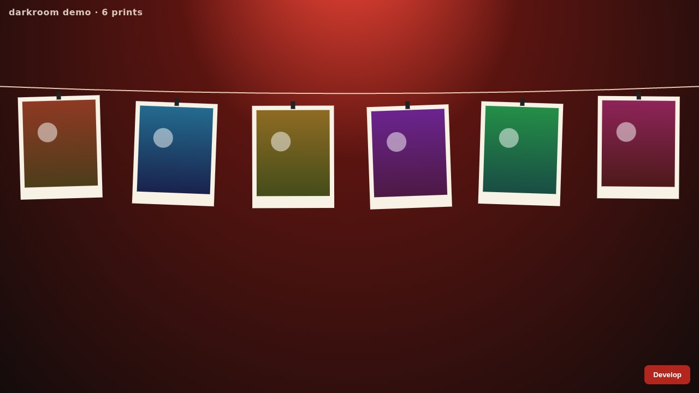
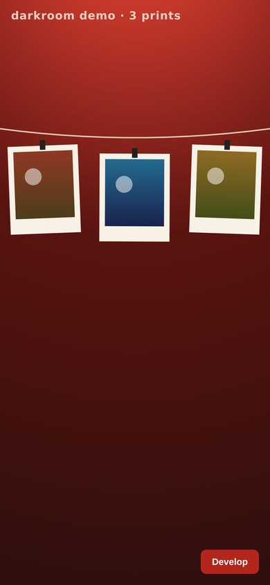
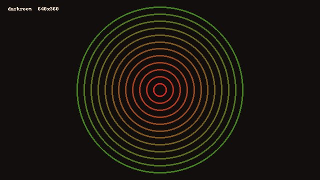
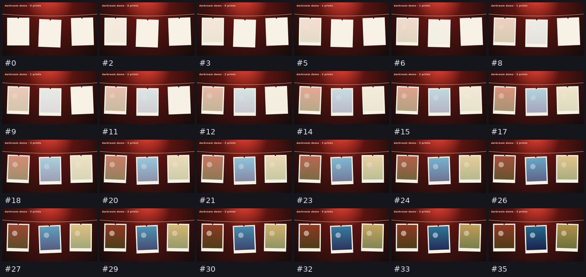

# darkroom

A small media-capture kit for project READMEs, release notes and pull requests. You write a
JSON shot list (`media.json`); darkroom drives a browser or runs your program, then makes
budget-fitted stills, GIFs, MP4/WebM clips, contact sheets, before/after pairs, captioned
grids and a markdown gallery you can paste anywhere.



*darkroom's own demo page, shot by `examples/static-page/media.json` (42 KB JPEG).*

- **Two backends.** `web` drives headless Chromium through Playwright (with a deterministic
  clock for [Strata](https://github.com/Preponderous-Software/strata) web-kit games, or any
  page through JS hooks). `command` runs any program that writes images (a native game's
  screenshot flag, an engine's headless renderer, a heavy server-and-bot rig), each on its
  own Xvfb display if you want one.
- **Budgets by default.** Stills under 200 KB, GIFs under 3 MB, MP4 under 600 KB, WebM under
  400 KB. darkroom steps quality, colours, width and frame rate down until a file fits, and
  says what it did.
- **Built for slow, crowded machines.** Every shot retries with a fresh browser or process,
  finished shots are skipped on the next run, a failing shot doesn't stop the others, and
  named file locks keep heavy rigs to one at a time.

## Install

Python 3.10 or newer. Pillow is the only required dependency.

```sh
pip install "darkroom[video] @ git+https://github.com/Preponderous-Software/darkroom"
```

- `[video]` adds `imageio-ffmpeg`, which ships an ffmpeg binary for MP4 and WebM. An
  `ffmpeg` on `PATH` (or `$DARKROOM_FFMPEG`) is used first. With neither, video outputs
  are skipped with a message and everything else still works.
- The `web` backend needs Node.js and Playwright (`npm i playwright && npx playwright
  install chromium`). darkroom looks for `playwright` in the manifest's `node_modules`, then
  `$NODE_PATH`, then `$DARKROOM_PLAYWRIGHT`.
- The `command` backend's `xvfb: true` needs `Xvfb` (`apt install xvfb`).

**Pin a version on shared machines.** Several projects on one machine can share one darkroom;
pin the tag so an upgrade there doesn't change your outputs under you:

```sh
pip install "darkroom[video] @ git+https://github.com/Preponderous-Software/darkroom@v0.3.0"
```

Each take's `meta.json` and each entry in `.darkroom/state.json` record the darkroom version
that made it (`"darkroom": "0.3.0"`). Upgrading does not by itself mark shots stale (see
[Takes, resume and re-encoding](#takes-resume-and-re-encoding)).

## Quickstart

```json
{
  "out": "docs/media",
  "vars": { "base": "http://127.0.0.1:8000/" },
  "shots": [
    {
      "name": "title", "kind": "still", "device": "desktop",
      "url": "{base}", "ready": "document.querySelector('canvas')",
      "caption": "The title screen.", "alt": "The game's title screen"
    },
    {
      "name": "walk", "kind": "clip", "device": "phone",
      "url": "{base}?demo=1",
      "steps": [ { "repeat": 24, "steps": [ { "key": "KeyW", "action": "down" }, { "wait": 80 }, { "capture": true } ] } ],
      "gif": { "fps": 12 }, "video": ["mp4"],
      "caption": "Walking north.", "alt": "Animation: the player walks north"
    }
  ]
}
```

```sh
darkroom check media.json                       # validate, with the exact place of each problem
darkroom shoot media.json                       # shoot everything that isn't up to date
darkroom shoot media.json --only walk --force   # reshoot one
darkroom shoot media.json --out /tmp/review     # every output into a scratch dir, for review
darkroom gallery media.json --relative-to README.md   # print markdown for the outputs
darkroom gallery media.json --insert README.md        # update the images in a doc in place
```

`darkroom shoot` prints each output and its size:

```text
> developing (clip, web)
  developing.gif: 334 KB
  developing.mp4: 42 KB (crf 23)
  developing.webm: 39 KB (crf 33)
  developing-poster.jpg: 19 KB
  developing-sheet.png: 484 KB
= desktop: up to date (use --force to reshoot)
```

## What it makes

| Shot | Output |
|---|---|
| a still on a 390x844 DPR-3 touch phone, after a `tap` and a `waitFor` |  |
| a clip: 36 frames, each stepped by a JS hook, as a GIF with an adaptive palette (plus MP4, WebM and a poster) |  |
| a before/after pair from two tagged runs of the same shot |  |
| a `command` still: any program that writes PNGs into `{out_dir}` |  |

A contact sheet of every frame of a clip (`darkroom sheet media.json developing`), for
reviewing a take before you publish it:



### Dogfood: Tangle

[Tangle](https://github.com/Preponderous-Software/tangle) is a first-person game on Strata.
`examples/tangle/media.json` is a port of its own capture script: it loads the game with
`?drive=1`, poses the player through the game's JS hook, steps the engine clock exactly
(`frames`), hides the HUD with `css`, and captures.


*The 12-frame cut of `triangle-closes` (118 KB GIF, 47 KB MP4), shot in software WebGL on a
heavily loaded machine. The full clip is 50 frames.*

## Manifest reference

Top level:

| Key | Meaning |
|---|---|
| `out` | Output directory, relative to the manifest (default `media`). |
| `vars` | Values for `{name}` placeholders in `url`, `ready`, `argv`, `env`, `cwd` and `file`. Vars may use other vars. `--var name=value` overrides. A var can be a list, spliced into `argv` as a whole `"@name"` entry (see [Shared flags](#shared-flags-list-vars-and-key)). Built in: `{manifest_dir}`; with `each`, `{value}`, `{i}`, `{n}`; and for `command` shots `{out_dir}`, `{work_dir}`, `{width}`, `{height}`, `{dpr}`, `{display}`, `{name}`, `{tag}`. Unknown placeholders are left alone, so JS and JSON braces are safe. |
| `devices` | Extra devices: `{ "name": { "width", "height", "dpr", "touch", "mobile" } }`. |
| `budgets` | `still_kb` (200), `gif_mb` (3), `mp4_kb` (600), `webm_kb` (400). A shot can override any of them in its own `budgets`. |
| `defaults` | Fields every shot starts from. Objects merge one level deep, lists are replaced unless the shot writes `KEY+` to extend them (`argv+`, `steps+`, `setup+`, `block+`, `launchArgs+`), and fields for the other backend are ignored. |
| `shots` | The list of shots. |

Every shot:

| Key | Meaning |
|---|---|
| `name` | Unique; becomes the file name (`name.jpg`, `name.gif`, ...). |
| `kind` | `still` (one image, or one per named `capture` or command `outputs` entry), `clip` (frames from `capture` steps), `pair` (before/after), `grid` (a captioned composite of other shots) or `prep` (a command that writes files, not images; see [Prep shots, inputs and depends](#prep-shots-inputs-and-depends)). |
| `backend` | `web` (default) or `command`. |
| `device` | `desktop` (1280x720), `hd` (1920x1080), `phone` (390x844, DPR 3, touch, mobile), `landscape-phone` (844x390), a custom name, or an inline `{ "width", "height", ... }`. |
| `caption`, `alt` | Used by the gallery. Say so in `alt` if `speed` > 1. |
| `format`, `quality`, `width` | Stills: `jpg` (default) or `png`, starting JPEG quality (86), maximum width. |
| `colors` | PNG stills, pairs and grids: quantize to at most this many colours (2 to 256). Budget fitting can still go lower. |
| `file` | Write the output to this path (relative to the manifest) instead of `<out>/<name>.<ext>`, so a shot can replace an existing image in place. The extension picks the format: `.jpg`/`.png` for stills, pairs and grids; `.gif`, `.mp4` or `.webm` for a clip (its other outputs share the name: `walk.gif`, `walk.mp4`, `walk-poster.jpg`). A tag goes before the extension (`seasons.before.png`). Vars, `{name}`, and with `each` `{value}`/`{i}`, are filled in. |
| `each` | `web` and `command`: a list of values, one run each (a fresh browser or process), with `{value}`, `{i}` and `{n}` set (also in the page's `vars`). Implies `repeat` = its length. A still makes one image per value (`name-<value>.jpg`, or the `file` template); a clip plays the runs in order. |
| `aspect` | Centre-crop every frame to a ratio such as `"16:9"` or `"1:1"`. |
| `fps`, `speed` | Clip playback rate (12) and a speed-up factor. |
| `every` | Clips: keep every Nth captured frame (2 halves a long take). `gif.every` and `video.every` override it for one output. Playback `fps` is unchanged, so the clip gets shorter. |
| `gif` | `{ fps, width (640), palette, colors (256), dither (false), loop (0), budget_mb, hold_last_ms, every }`, or `false` for no GIF. Palettes: `adaptive` (the default: one octree palette for the whole clip, so no colour flicker, and the smallest files), `octree` (a palette per frame; keeps small saturated details), `median` (per frame, median cut). `hold_last_ms` shows the last frame that long before the loop restarts. See [GIF size](#gif-size) for how frames are stored. |
| `video` | `["mp4"]`, `["webm"]` or both; or `{ "formats": ["mp4"], "every": 2, "hold_last": 1.5 }`, where `hold_last` holds the last frame that many extra seconds. |
| `poster` | Frame for a poster JPEG: an index, or a fraction of the clip (default 0.6 when there is video). |
| `sheet` | `true` also publishes the contact sheet as `<name>-sheet.png` (one is always kept with the take for review); or `{ "labels": "none" \| "index" \| "caption", "cols": 4, "width": 1600 }`. `index` (default) labels tiles `#3`; `caption` uses each frame's `each` value. |
| `retries`, `timeout`, `lock` | Attempts after the first (2), seconds per attempt, a lock name. |
| `gallery` | How the gallery shows the shot: `{ "width": 480 }` writes ``; `"poster": true` shows a clip's poster beside its GIF (and makes the poster). Changing it never reshoots. |
| `skip` | Leave the shot out of `shoot`. |
| `inputs` | Paths or globs (relative to the manifest, templated) whose file contents feed the capture hash: a changed, added or removed file reshoots the shot. A directory stands for every file under it. |
| `depends` | Shot names that run first. A `prep` named here also runs under `--only` (unless it is up to date), and its `outputs` count as this shot's `inputs`. |

### The web backend

| Key | Meaning |
|---|---|
| `url` | The page (templated). `file://{manifest_dir}/index.html` works for static pages. |
| `adapter` | `hook` (default; any page, waits are wall-clock) or `strata-kit` (waits for `window.__strataKit`; `frames` drives its clock by exactly `frameStep` seconds per frame; `camera` sets `__strataKit.cam`). |
| `frameStep` | `strata-kit`: game seconds per driven frame (default `1/30`). A `frames` step can set its own `step`. |
| `screenshotTimeout` | Milliseconds for every Playwright call that can time out: screenshots, clicks, taps, navigation. Default: the shot's `timeout`, else 120000. (Playwright's own 30 s default fails every attempt on a heavily loaded machine rendering WebGL in software.) |
| `ready` | A JS expression to wait for before the steps (default `window.__strataKit` or `true`). |
| `readyTimeout`, `waitUntil` | Milliseconds to wait for the page (120000) and the navigation event (`load`, `domcontentloaded`, `commit`). |
| `css` | Styles injected once the page is ready (hide the HUD). |
| `setup`, `steps` | Step lists, run in that order. A still is the page after the steps; a clip is every `capture`. |
| `crop` | `[x, y, width, height]` in CSS pixels: capture only that part of the page. |
| `failOnConsoleError` | Fail the attempt if the page logs an error (errors are always reported). |
| `userAgent`, `block` | darkroom appends `darkroom-monitor` to Chromium's user agent, so sites that count visits can skip captures. `block` is a list of URL patterns to abort (analytics, scores). |
| `launchArgs` | Chromium flags. The default renders WebGL with SwiftShader, so it works headless and in CI. |
| `initScript` | JS that runs in every page before the page's own scripts (Playwright's `addInitScript`): seed `localStorage` or a save file, or wrap `requestAnimationFrame` with a clock you can freeze. A string (vars filled in, like `url`), `{ "file": "tools/capture-init.js" }` (relative to the manifest; the path is templated, the file is sent as it is), or a list of those, run in order. A file's contents feed the capture hash. |
| `context` | Extra Playwright `browser.newContext` options, passed through: `locale`, `timezoneId`, `colorScheme`, `reducedMotion`, `geolocation`, `permissions`, `extraHTTPHeaders`, ... String values are templated. `viewport`, `deviceScaleFactor`, `hasTouch`, `isMobile` and `screen` come from `device`, and `userAgent` from `userAgent`. |

Steps (one verb per object):

| Step | Does |
|---|---|
| `{"js": "expr or statements"}` | Runs in the page. Sees `vars`, and inside a `repeat`: `i`, `n` and `u` (`i / (n - 1)`, for easing). |
| `{"key": "KeyW", "action": "down"}` | `down`, `up` or `press` (default). |
| `{"type": "hello"}` | Types text. |
| `{"tap": [x, y]}` / `{"tap": "css selector"}` | A touch tap (on touch devices; a click otherwise), at a point or at the centre of the first matching element. |
| `{"click": "css selector"}` | Clicks an element. |
| `{"wait": 250}` | Waits, in wall-clock milliseconds. |
| `{"waitFor": "js expr", "timeout": 30000}` | Waits until the expression is truthy: game state, not guesswork. Fails the attempt if it never is. |
| `{"frames": 6}` / `{"frames": 3, "step": 0.1}` | `strata-kit`: drives 6 frames of game time (`step` seconds each; default `frameStep`). `hook`: waits 6 animation frames. |
| `{"camera": {"yaw": 0.5, "dist": 8}}` | `strata-kit` only: sets any of `yaw`, `pitch`, `dist`, `tx`, `ty`, `tz`. |
| `{"css": "..."}` | Injects styles at this point. |
| `{"capture": true}` | Adds a frame to a clip. |
| `{"capture": "name"}` | In a still: writes `name.jpg` (or `.png`) beside the shot's outputs. Several in one shot make several stills from one browser session, with no replays. Names are unique per shot. |
| `{"goto": "url"}` / `{"reload": true}` | Navigates (relative to the current page; vars are filled in) or reloads, then waits for `ready` and re-applies `css`, as at the start. The `strata-kit` clock starts again. |
| `{"until": "js expr", "steps": [...], "max": 40, "then": 2}` | Runs the steps, then checks the expression, until it is truthy or `max` passes have run (a warning, not a failure), then `then` more passes. Inside: `i`, `n` (= `max`), `u`. |
| `{"mark": "in"}` / `{"mark": "out"}` | Trims the clip to the frames between the marks. |
| `{"repeat": 36, "var": "i", "steps": [...]}` | Runs the inner steps `n` times. |

### The command backend

| Key | Meaning |
|---|---|
| `argv` | The program and its arguments, templated. It must write image files into `{out_dir}` (a fresh temporary directory per run). |
| `env`, `cwd` | Extra environment (templated) and working directory. The default `cwd` is `{work_dir}`, a fresh scratch directory per run beside `{out_dir}` and deleted after it, so whatever else the program writes (an `imgui.ini`, logs, caches) never lands in your project and never becomes a frame. Relative paths in `argv` still mean the manifest's: the program when it has a slash (`./build/Game`), and any other entry that names an existing file next to the manifest (`render.py`) or an existing path with a slash (`scenes/title.json`). Paths inside a flag (`--scene=scenes/a.json`) and in `env` are not rewritten; write `{manifest_dir}/...` there. Set `"cwd": "{manifest_dir}"` for 0.1's behaviour; a relative `cwd` is relative to the manifest. |
| `xvfb` | `true` (or `{ "args": [...] }`) runs the program on a private Xvfb display sized to the device. Xvfb picks a free display number itself, so parallel captures never collide; `{display}` and `$DISPLAY` hold it. Xvfb and the program run with software OpenGL (`LIBGL_ALWAYS_SOFTWARE=1`, `GALLIUM_DRIVER=llvmpipe`), which keeps GLX working where a host GPU driver would crash it (e.g. NVIDIA under WSL), so the program gets real OpenGL; `{ "env": {...} }` replaces those variables and `{ "env": {} }` drops them. If Xvfb still crashes at startup, darkroom starts it once more without GLX and warns. |
| `repeat` | Run the program `n` times with `{i}` and `{n}` set; every image from every run is a frame, in order (camera orbits, scenario steps). `each` (above) does the same with a value per run. |
| `glob` | Which files to collect (default: every PNG, JPEG, WebP or BMP, sorted). |
| `outputs` | Stills: named outputs from one run. `{ "top": "top.png", "oblique": "oblique.png" }` maps files the program writes into `{out_dir}` to `<name>-top.jpg` and `<name>-oblique.jpg` (or the `file` template with `{key}`, e.g. `"docs/views/{key}.png"`); other files it writes are ignored, and a missing one fails the attempt. An entry can be `{ "file": "top.png", "caption": "...", "alt": "..." }` to give that image its own gallery caption and alt text (changing them never reshoots). Not with `each`, `repeat` or `glob`. |

`examples/recipes/media.json` shows a native game with its own screenshot flags at two
sizes, an engine's headless renderer, two builds compared as a pair, a RAM-heavy rig
behind a lock, and one still per season composed into a captioned grid.

### Prep shots, inputs and depends

Some captures need a slow run that writes data, not images: a throwaway server and a few bots
for several minutes, a simulation, a build. A `prep` shot runs such a command once, and cheap
shots render images from what it wrote:

```json
{
  "shots": [
    { "name": "rig", "kind": "prep", "lock": "server",
      "argv": ["./tools/run-rig.sh", "--minutes", "5"], "outputs": ["build/rig/stats.json"] },
    { "name": "stats-chart", "backend": "command", "depends": ["rig"],
      "argv": ["python3", "tools/chart.py", "build/rig/stats.json", "{out_dir}/chart.png"] }
  ]
}
```

A prep takes `argv`, `env`, `cwd`, `xvfb` (with `device` for its size), `lock`, `timeout`,
`retries`, `inputs`, `depends` and `outputs` (required): the files it writes, relative to the
manifest. Its default `cwd` is the manifest's folder, since writing files there is its job.
It is up to date (and skipped) when its argv, env, vars and inputs have not changed and every
declared output still exists; a missing output after the run fails it. It makes no media and
does not appear in the gallery. `--force` reruns it only when it was selected (no `--only`, or
named in `--only`). `--encode` leaves it alone; under `--tag` it still runs, untagged (a tag
never goes into a prep's name or state).

`depends` orders shots: each runs after the shots it names (otherwise manifest order, with
pairs and grids last). `darkroom shoot --only stats-chart` also runs `rig` first, unless it is
up to date. When a shot fails, the shots that depend on it are skipped and counted as failed.
A shot that depends on a prep treats the prep's outputs as `inputs`, so new data reshoots it.
`inputs` works on any shot: `"inputs": ["scenes/*.json", "assets/"]` reshoots when a matching
file changes, appears or disappears.

### Shared flags: list vars and `KEY+`

A var can be a list. As a whole `argv` entry, `"@name"` splices its items in (a scalar var
gives one entry; `@word` that is not a var is left alone, so `@file` arguments survive):

```json
{
  "vars": { "game": "./build/MyGame", "common": ["--fast", "--seed", "7", "--no-audio"] },
  "defaults": {
    "backend": "command", "xvfb": true,
    "argv": ["{game}", "@common", "--screenshot-dir", "{out_dir}"]
  },
  "shots": [
    { "name": "title" },
    { "name": "map", "argv+": ["--open", "map"] },
    { "name": "seasons", "argv+": ["--season", "{value}"], "each": ["spring", "summer", "autumn", "winter"] }
  ]
}
```

`argv+` appends to the default's `argv`, so every shot keeps the shared flags without
copying them. `--var common="--fast --seed 9"` overrides a list var (split like a shell).
A list var inside a string (`"--x={common}"`) is an error: splice it with `@common`.

### Grids

A grid is a README composite: tiles in rows, a caption under each, an optional title, and
no frame numbers. Tiles share the first tile's aspect ratio.

```json
{ "name": "season", "backend": "command", "each": ["spring", "summer", "autumn", "winter"],
  "argv": ["{game}", "@common", "--season", "{value}", "--screenshot-dir", "{out_dir}"] },
{ "name": "seasons", "kind": "grid", "of": "season", "title": "The four seasons",
  "captions": ["Spring", "Summer", "Autumn", "Winter"], "file": "docs/images/seasons.png" }
```

| Key | Meaning |
|---|---|
| `of` | A still or clip whose take supplies the tiles: one per run for an `each`/`repeat` shot (its last frame), otherwise every frame. Captions default to the `each` values. |
| `frames` | With `of`: pick frames of the take by index (negative counts from the end). |
| `tiles` | Instead of `of`: a list of shot names (the last frame of each take) or objects `{ "shot", "frame", "caption" }` / `{ "image": "path", "caption" }`. A tile's caption defaults to its `each` value, then its shot's `caption`. |
| `captions` | One caption per tile, overriding the defaults (`""` for none). |
| `cols` | Columns (default: one row up to three tiles, 2x2 for four, then a square-ish grid). |
| `title` | A title above the tiles. |

The grid is about 1600 px wide (tiles are never upscaled), then budget-fitted like a still;
`width`, `format`/`file`, `quality` and `aspect` work as for stills. Grids and pairs are made
after the shots they read, and every time (they are cheap).

### Pairs

```json
{ "name": "title-compare", "kind": "pair", "of": "title", "labels": ["before", "after"] }
```

Shoot the source shot twice with tags, then the pair:

```sh
darkroom shoot media.json --only title --tag before --var game=./old/MyGame
darkroom shoot media.json --only title --tag after
darkroom shoot media.json --only title-compare      # or: darkroom pair media.json title-compare
```

Tagged runs write `title.before.jpg` and `title.after.jpg`. A pair can also take two image
paths: `"before": "a.png", "after": "b.png"`.

## Takes, resume and re-encoding

Each shot's raw frames are kept as a take in `.darkroom/takes/<name>/` next to the manifest,
with a `meta.json` (device, frames, console errors, attempt, time, darkroom version, capture
hash) and a contact sheet. Add `.darkroom/` to your `.gitignore`.

`darkroom shoot` keeps two hashes per shot:

- the **capture hash**: only what changes the pixels captured (the url or argv, steps, setup,
  device, adapter, ready, css, crop, `initScript`, `context`, the vars, the contents of the
  shot's `inputs`, and so on). When it changes, the shot is reshot.
- the **encode hash**: what changes the files made from a take (format, quality, width, `gif`,
  `video`, `poster`, `sheet`, `aspect`, `speed`, `fps`, `every`, `colors`, `file`, budgets).
  When only this changes, the saved take is re-encoded without reshooting.

Neither includes the darkroom version, `retries`, `lock`, `timeout`, `screenshotTimeout`,
`comment`, `caption`, `alt` or `gallery` width, so changing those (or upgrading) never marks a
shot stale. State written by darkroom 0.1 or 0.2 is recognised and adopted on the first 0.3 run
when the shot has not changed.

`--out DIR` writes every output into `DIR`, including shots with a `file`, and keeps its own
record in the state, so a review shoot never touches the real outputs. The takes are shared,
so a later normal `shoot` re-encodes from them instead of reshooting.

```sh
darkroom shoot media.json --encode --only walk   # re-encode the last take (new budget, palette, aspect) without reshooting
darkroom sheet media.json walk                   # contact sheet of a take -> <out>/walk-sheet.png
darkroom sheet .darkroom/takes/walk              # the same, from the take folder
darkroom sheet path/to/folder -o review.png      # contact sheet of any folder of images
```

Sheets are for reviewing takes. Tiles are sized from the frames so the sheet is about 1600 px
wide (`--width`; `--thumb` fixes the tile width; small frames are not upscaled), up to 24
frames spread evenly across the take, labelled with the frame index (`--labels index`), the
`each` value (`--labels caption`) or nothing (`--labels none`). With no `-o`, a manifest's
sheet goes into its out dir, a take folder's into its manifest's out dir, and a plain
folder's beside the folder (`<folder>-sheet.png`); nothing is written into a take. For a
README composite use a [grid](#grids) instead.

### GIF size

darkroom writes GIFs itself (with Pillow's LZW encoder for each frame's pixels) instead of using
Pillow's optimizer, whose trimmed per-frame palettes can leave colour indices past the end of
the table (ImageMagick rejects those files: "invalid colormap index"). Every frame after the
first keeps only what changed: pixels that are the same as in the frame before become a
reserved transparent index, and the frame is cropped to the box around the changes (or stored
as a plain crop, when that is smaller). Frames are not disposed, so each paints over the
last, and every frame's colour table is complete: one global 256-entry table for `adaptive`,
or a full table per frame for `octree` and `median`. Identical frames are merged into one
longer frame. A mostly static clip (a HUD, a small character moving on a still scene) shrinks
several times over; a clip where the whole frame moves gains a little.

## Locks

`"lock": "browser"` on a shot takes an exclusive `flock` on `/tmp/darkroom-locks/browser.lock`
(`$DARKROOM_LOCK_DIR` to move it) for the whole capture. Any number of darkroom processes,
in any project, then take turns: use it for anything RAM-heavy or anything that must never
run twice at once. Locks are released when the process exits, even on a crash.

## Gallery

```sh
darkroom gallery media.json --relative-to README.md          # markdown on stdout
darkroom gallery media.json --insert README.md               # fill the markers below
darkroom gallery media.json --format html --write docs/media/index.html
darkroom gallery media.json --insert ../pr-body.md \
  --base-url https://raw.githubusercontent.com/OWNER/REPO/BRANCH/   # a PR body outside the repo
```

`--insert` fills two kinds of marker. A whole-gallery block gets every shot:

```markdown
<!-- darkroom:start -->
<!-- darkroom:end -->
```

A per-shot block gets one shot, so images can sit anywhere in your prose. Write either form;
the self-closing one is expanded into the other on the first run, and later runs replace
what is between the markers:

```markdown
The seasons change as you play:

<!-- darkroom:shot seasons /-->

<!-- darkroom:shot walk -->
<!-- darkroom:end -->
```

A marker naming an unknown shot is an error; a shot with nothing shot yet is left as it is.

Each shot becomes its image (a GIF before a still; a video becomes a poster linked to the
MP4; a still with `each`, one image per value), its caption in italics, and a link to the
MP4 when a clip has both.

Markers inside inline code (`` `<!-- darkroom:shot NAME /-->` ``) or fenced code blocks are
documentation and are left alone, so a README can show how to write them.

A shot's `gallery` options change how it is shown: `"width": 480` writes an `` tag with
that width instead of ``, and `"poster": true` puts a clip's poster beside its GIF.

**Links.** The project root is the git work tree holding the manifest (or the manifest's
folder outside git). When the document is inside it, links are relative to the document.
With `--base-url`, every link is that URL plus the file's path in the root, which resolves
anywhere (PR bodies, release notes, issue comments). A document outside the root without
`--base-url` is an error: darkroom never writes `../../..` paths out of the repo or a local
absolute path.

## Exit codes

`0` everything worked; `1` at least one shot failed (the others still ran); `2` the manifest
is invalid, a name is unknown, or the gallery cannot link a document (see **Links** above).

`darkroom check` also warns, without failing, about things that look wrong but may be fine at
shoot time: a command shot's (or prep's) program that is not on `PATH` or not at its path,
relative path-looking `argv` entries (with a `/`, or a script or data extension such as `.py`
or `.json`) that do not exist, `inputs` that match no files and `initScript` files that do
not exist. Paths a prep declares in `outputs` and entries filled in at run time (`{out_dir}`,
`{value}`, ...) are not reported.

## Credits

darkroom gathers capture code that several projects had each written for themselves: a
web-game trailer recorder (VP9 and H.264 with a CRF ladder to a size budget, posters,
contact sheets, `meta.json` per take, `crop`/`aspect`/`speed`/`poster`, in/out marks,
re-encoding the last take, a `monitor` user agent and a fresh browser per take), a GIF maker
with an octree palette, a captioned before/after composer, contact-sheet scripts, Tangle's
and other Strata games' Playwright shot lists, and the stepped-clock capture in
[playtester](https://github.com/Preponderous-Software/playtester). darkroom does not depend
on playtester.

## License

MIT. See [LICENSE](LICENSE).
